# Unlace Architecture

This document maps the unlace decompiler architecture using mermaid diagrams.
Generated 2026-06-27 from the current crate structure.

## Crate Dependency Graph (Core Pipeline)

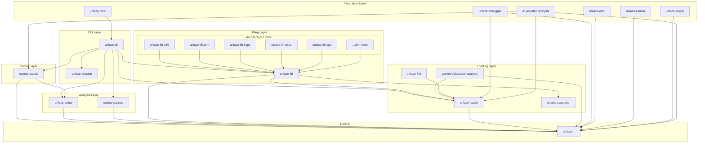

## Decompilation Pipeline Flow

```mermaid
flowchart LR
    subgraph Input
        binary[Binary File]
    end

    subgraph Load["1. Load"]
        parse[Parse Format]
        packer_id[Packer/obfuscator ID]
        recover[Unpack/rebuild evidence]
        sections[Extract Sections]
        symbols[Load Symbols]
        debug[Parse Debug Info]
    end

    subgraph Lift["2. Lift"]
        decode[Decode Instructions]
        semantics[Generate IR Semantics]
        cfg[Build CFG]
    end

    subgraph Transform["3. Transform"]
        ssa[SSA Construction]
        prop[Propagation Passes]
        dce[Dead Code Elimination]
        type_recovery[Type Recovery]
        stack[Stack Frame Recovery]
        calling[Calling Convention]
    end

    subgraph Structure["4. Structure"]
        dom[Dominator Tree]
        loops[Loop Detection]
        conditionals[If/Else Recovery]
        switches[Switch Recovery]
        hir[HIR Construction]
    end

    subgraph Emit["5. Emit"]
        cleanup[Post-processing]
        naming[Variable Naming]
        cprint[C Printer]
    end

    subgraph Output
        ccode[C Source]
    end

    binary --> parse
    parse --> packer_id
    packer_id --> recover
    recover --> sections
    sections --> symbols
    symbols --> debug

    debug --> decode
    decode --> semantics
    semantics --> cfg

    cfg --> ssa
    ssa --> prop
    prop --> dce
    dce --> type_recovery
    type_recovery --> stack
    stack --> calling

    calling --> dom
    dom --> loops
    loops --> conditionals
    conditionals --> switches
    switches --> hir

    hir --> cleanup
    cleanup --> naming
    naming --> cprint

    cprint --> ccode
```

## C Printer Module Structure (Current)

The `c_printer` module is ~32k lines and needs extraction into focused submodules.

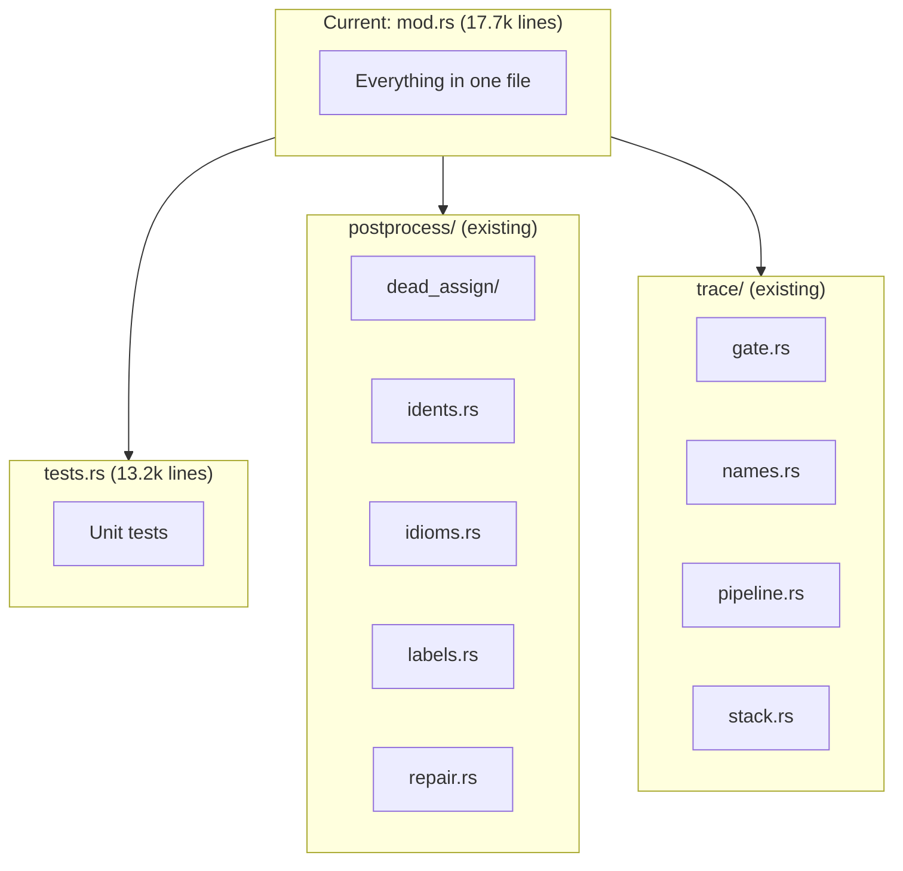

## C Printer Module Extraction Plan

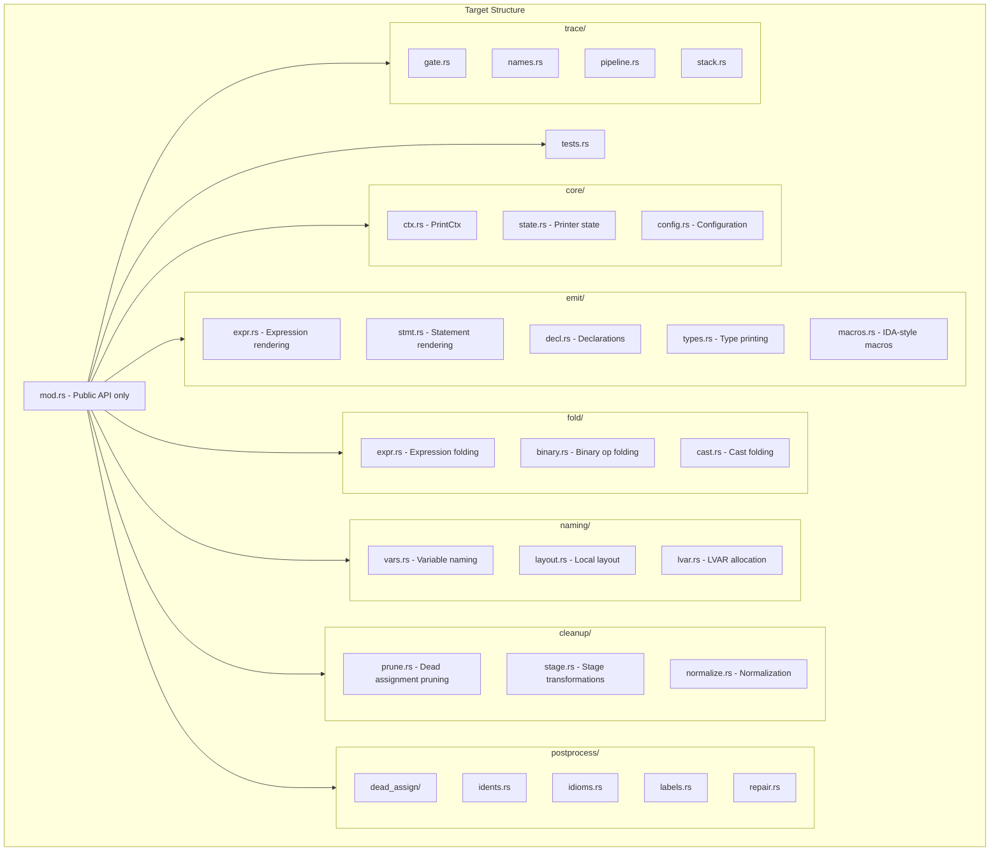

## Architecture Lifters Coverage

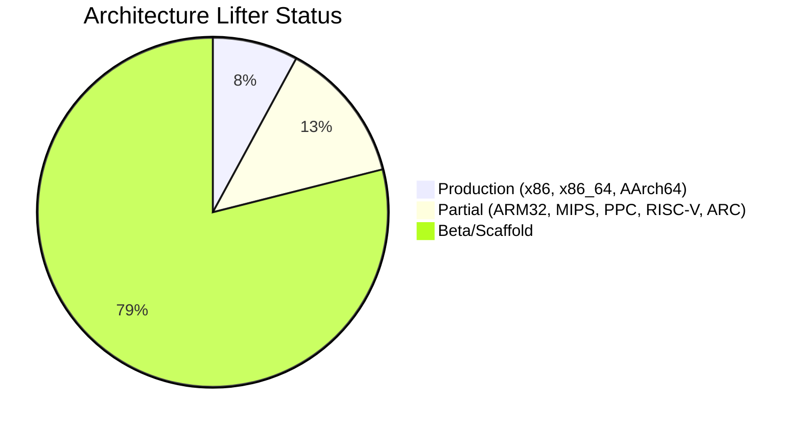

## Structurer Module Structure

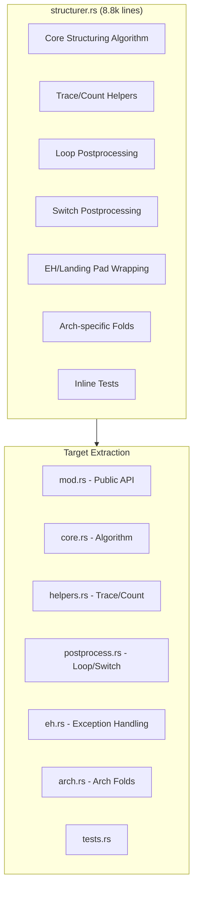

## Quality Metrics Dashboard

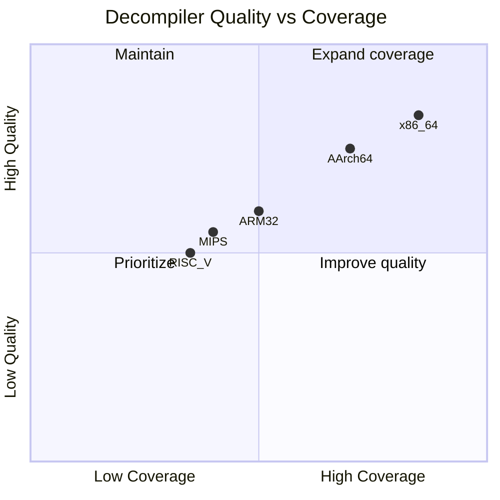

## Phase Roadmap (from PARITY_PLAN.md)

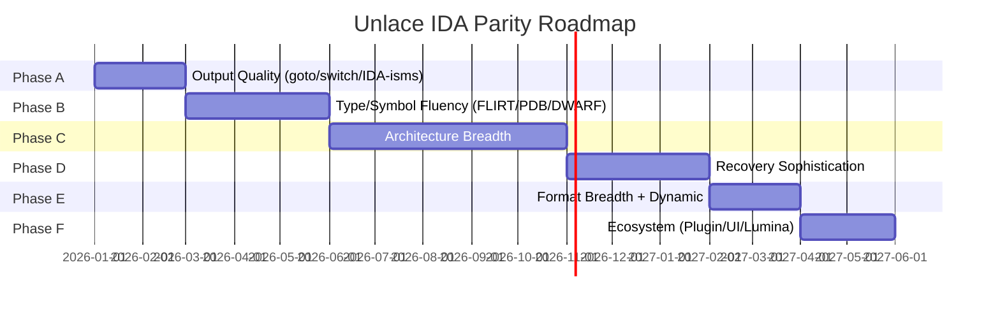

## Quality Metrics Definitions

Unlace uses several distinct metrics. None of them measure "how similar to IDA" — they measure actual decompilation quality.

### 1. Semantic Correctness (`xtask semantic-report`)

**What it measures:** Does the decompiled C compile and produce the same exit code as the original binary?

This is the only metric that proves the decompilation is *correct*. A function passes if:
1. The emitted C compiles with the system C compiler
2. Running it produces the same observable behavior as running the original binary

**Current:** 34/34 pass (21 host executable, 4 qemu-user, 9 source-shape verified)

### 2. Type Recovery (`xtask type-recovery-report`)

**What it measures:** How many type facts from DWARF/source does unlace recover in its output?

- **Recall** = recovered facts / expected facts from debug info
- **Precision** = recovered facts / total emitted facts

High recall means we don't miss known types. High precision means we don't emit garbage types.

**Current:** 100% recall, 93% precision

### 3. Golden Triage (`xtask golden-triage`)

**What it measures:** Do stored expected outputs match current output exactly?

This is a *regression detector*, not a quality score. It catches unintended output changes.

**Current:** 15 exact-pass, 0 review rows

### 4. Stylistic Score (`scripts/score_parity.sh`)

**What it measures:** Structural feature presence in decompiled output.

This is a *watchdog metric* that counts control-flow patterns, variable declarations, and expression shapes. It does NOT measure similarity to IDA — it measures whether output has the structural features we expect.

The 83% number means "83% of expected structural features are present in output." It is NOT "83% similar to IDA."

### 5. Function Quality (`unlace quality <binary>`)

**What it measures:** Per-function quality counters that flag implementation gaps.

- `unimplemented_ops`: Lifter had no handler
- `callother_ops`: Opaque intrinsics leaked to output
- `lost_frame_offsets`: Stack references that should be named locals
- `null_derefs`: Bogus `*(T*)0` expressions
- `unknown_types`: Types that couldn't be inferred

Lower is better for all of these.

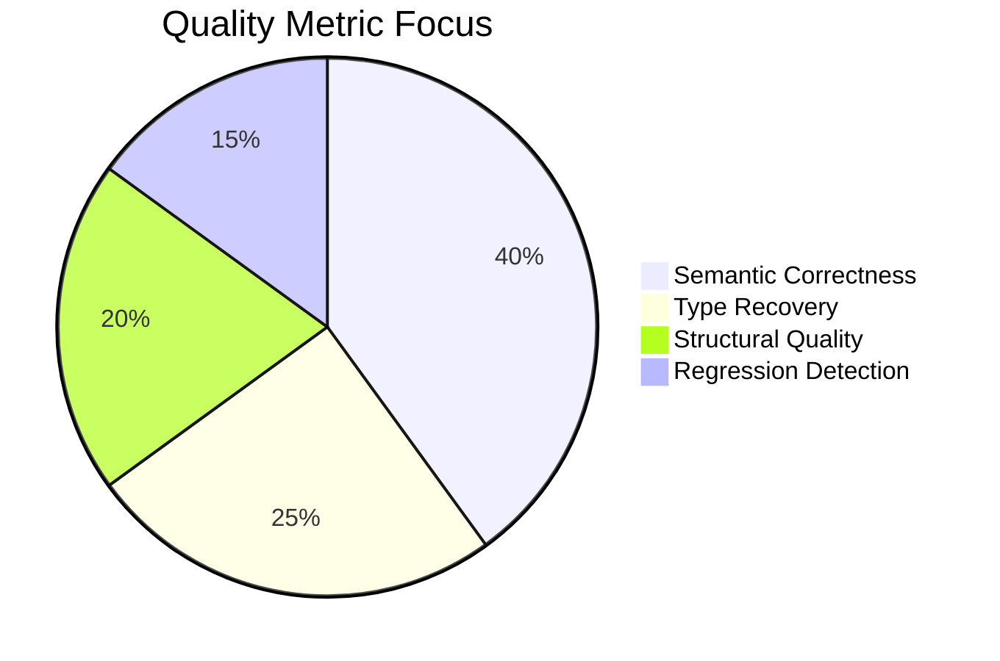

| Metric | Current | Target | What It Proves |
|--------|---------|--------|----------------|
| Semantic Pass | 34/34 | 50+ | Output is *correct* |
| Type Recall | 100% | 100% | No missed recoverable facts |
| Type Precision | 93% | 98%+ | No garbage emissions |
| Golden Exact-Pass | 15 | 50+ | No unintended regressions |
| Stylistic Score | 83% | 95%+ | Structural completeness |
| Production Archs | 3 | 20+ | Architecture breadth |

### Where Unlace Already Exceeds IDA

- **Deterministic output** — IDA can vary between runs; unlace is byte-identical
- **Better type inference** — on some optimized code, unlace recovers types IDA misses
- **Cleaner expression folding** — in measured cases, fewer redundant casts/temps
- **Measurable quality** — every claim has a verification command

## Data Flow: Binary to C

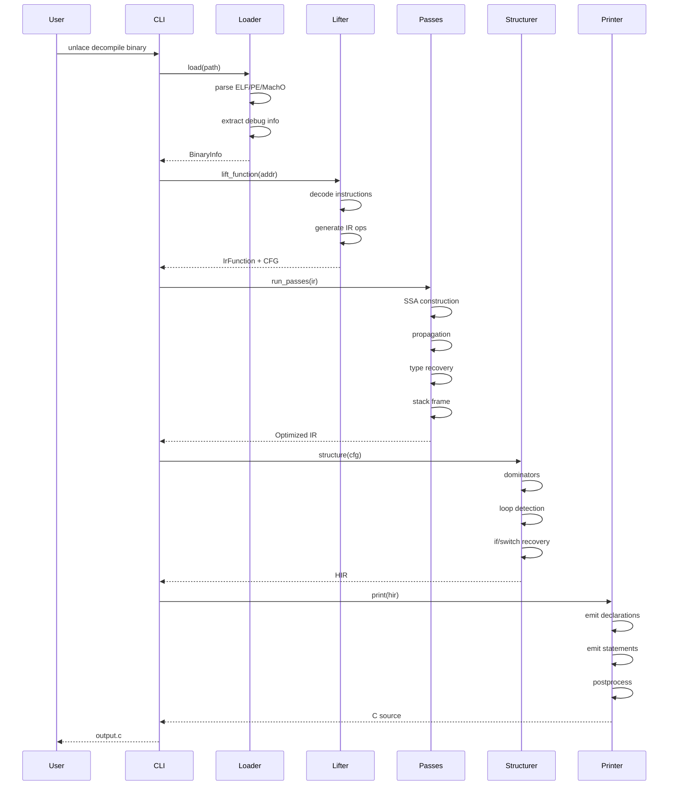

## Packer / Obfuscator and AI-Assisted Analysis Lane

Packed and adversarial binaries enter the normal decompilation pipeline only
after unlace records what was observed and what was recovered. Packer support is
not a printer trick: loader facts should capture section anomalies, entropy,
entrypoint location, import table damage, TLS callbacks, rebuilt IATs, unpacked
image provenance, and known signatures such as UPX remnants or Scylla rebuild
sections.

The Magic Dork sample (`xdumpgo.exe` on disk) made the missing architecture
concrete: IDA can recover functions from nameless RWX sections plus `.pdata`,
while unlace currently needs a conventional `.text` name before lifting. The
planned loader surface should select executable sections by entrypoint ownership
and permissions, build a function index from `.pdata` / TLS / imports / Go module
metadata, and stream per-function AST/HIR/quality artifacts with progress and
retry state.

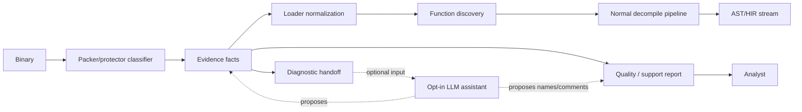

External IDA/Hex-Rays dumps are a reference lane, not a dependency. Headless
`idat` scripts are best for isolated long jobs when all-or-nothing output is
acceptable; idalib per-function loops are better for huge or fragile databases
because they write resumable `sub_*.c` files. Unlace should consume both through
a manifest-backed corpus importer.

The LLM lane is advisory. It can propose packer IDs, function names, string/API
hash explanations, and triage hypotheses, but accepted project facts still come
from deterministic evidence: bytes, loader structures, IR, debugger/emulator
observations, corpus comparisons, and user-approved annotations. Provider
credentials remain runtime configuration and must not be serialized in project
state or reports.

The diagnostic handoff is the boundary between deterministic loading and
agent-assisted work. It should contain enough facts for an external model or
human to plan unpacking/deobfuscation without re-running discovery: hashes,
section table, entropy, import/TLS/exception directories, function-index source,
tool fingerprints, failed loader step, safe next commands, and explicit execution
policy.

## Module Ownership

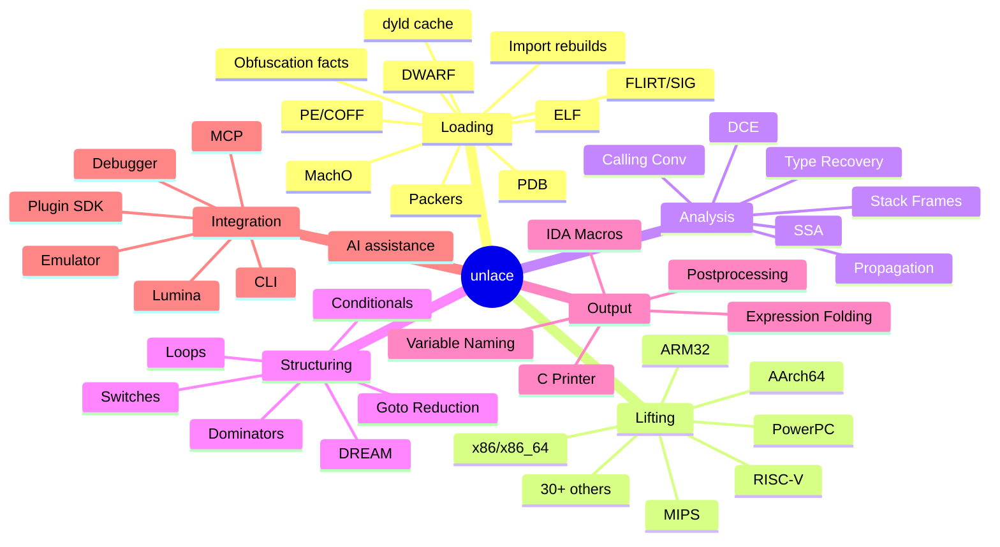
