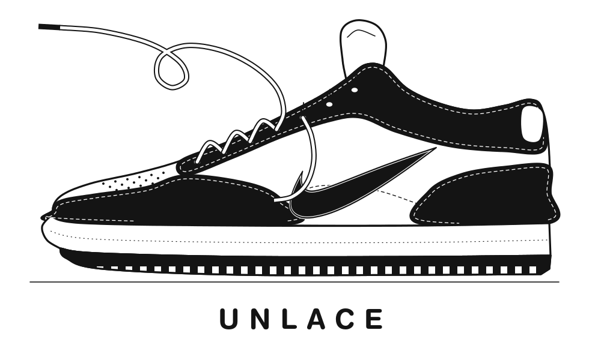

<p align="center"></p>

<h1 align="center">Unlace</h1>

<p align="center">An agent-first decompiler written in Rust.</p>

<p align="center">
  <a href="https://github.com/coleleavitt/unlace/actions/workflows/tests.yml"></a>
  <a href="LICENSE"></a>
</p>

Unlace exposes the decisions inside the decompiler as named options that an agent (or a person)
can flip per run, lists them with `unlace catalog`, and speaks `--json`, so an LLM can drive it
end to end. Its engine comes from [Kuna](https://github.com/Noelo-Lab/kuna), a Rust port of
[Ghidra](https://github.com/NationalSecurityAgency/ghidra)'s decompiler; Unlace adds Apple
platform support (Mach-O, chained fixups, the dyld shared cache, kernelcaches, Objective-C,
Swift, arm64e) and fixes found by comparing its output against IDA 9.5.

| Measured locally, 2026-11-22 | Unlace | IDA 9.5 |
|---|---|---|
| [DecBench](https://decbench.com) O2-noinline, functions with GED 0 | 36.8% | 36.6% |
| DecBench O2-noinline, mean GED (lower is better) | 11.08 | 11.61 |
| Type match, perfect functions on a gcc corpus | 16.9% | 12.2% |

## Install

There are no binary releases yet. With a Rust toolchain:

```bash
git clone https://github.com/coleleavitt/unlace && cd unlace
make                                   # builds the binaries and compiles the SLEIGH specs
export PATH="$PWD/decompiler/target/release:$PATH"
```

## Usage

```bash
unlace decompile ./a.out main                          # one function by name
unlace decompile ./stripped.bin 0x401040 --addr        # or by address
unlace decompile-project ./a.out                       # the whole binary as .c/.h/.asm
unlace decompile ./a.out main --option compareform canonical   # flip a decision
unlace catalog                                         # every option and what it fixes
unlace install-skill                                   # teach Claude Code, Codex or OpenCode to use it
```

Unlace can also replace Ghidra's own decompiler, in the GUI or headless; see the
[Ghidra extension README](integrations/ghidra/KunaDecompiler/README.md). The full CLI reference is
[docs/cli.md](docs/cli.md).

## History

Unlace began on 2026-04-29 as a from-scratch decompiler with its own IR, structuring, 40+
lifters, debugger and emulator; that code is archived on the `master` branch (tag
`unlace-v1-final`). On 2026-11-22 Unlace moved onto Cole's Kuna fork, which carried the Apple
work ported from it.
[docs/architecture/decompiler-ir-landscape.md](docs/architecture/decompiler-ir-landscape.md)
compares the two designs.

## Contributing

[docs/dev-setup.md](docs/dev-setup.md) has the build recipe, the local gates and the git hooks;
[CLAUDE.md](CLAUDE.md) has the rules agents follow in this repo. Before a commit:
`make test`, `make test-stages`, `make check-spec` and `cd decompiler && cargo fmt --all --check`.

## License

Apache-2.0; see [LICENSE](LICENSE) and [NOTICE](NOTICE). Unlace builds on Kuna by Zion Basque
and contributors, whose work is sponsored by the
[Air Force Research Lab](https://www.afrl.af.mil/), [Metalware](https://www.metalware.com/) and
the Department of Defense, and on Ghidra by the NSA.
