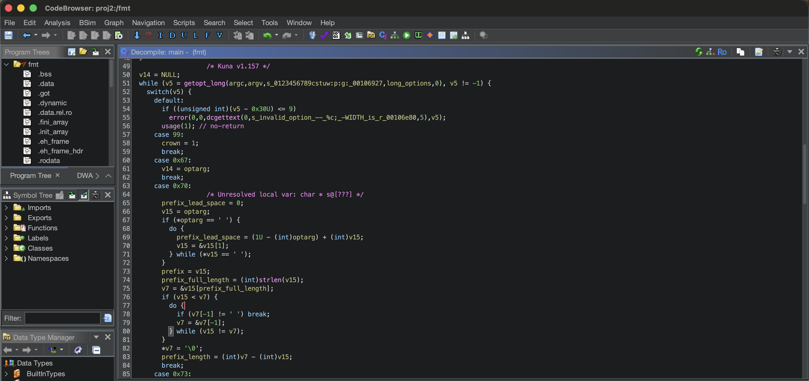

# unlace

unlace is an **agent-first decompiler written in Rust**: the decisions inside the decompiler are
exposed as named options that an agent (or a person) can flip per run, and `unlace catalog` lists
them with the symptoms each one addresses. It ships an agent skill (`unlace install-skill`) and
JSON output for every command, so an LLM can drive it end to end. Its engine comes from [Noelo-Lab/kuna](https://github.com/Noelo-Lab/kuna), which began
as a Rust port of [Ghidra](https://github.com/NationalSecurityAgency/ghidra)'s decompiler and
SLEIGH compiler. On top of that engine, unlace adds Apple platform support (Mach-O, chained
fixups, the dyld shared cache, kernelcaches, Objective-C and Swift metadata, arm64e) and fixes
found by comparing the output against IDA 9.5. It keeps kuna's phase model, option catalog and
parity gates, and it merges kuna regularly.

## History

unlace started on 2026-04-29 as a from-scratch decompiler aimed at Hex-Rays and Ghidra parity.
It had its own IR with SSA, its own control-flow structuring and C printer, more than 40
per-architecture lifters, its own loaders (ELF, PE/COFF, Mach-O, the dyld cache, DWARF and PDB
ingest, FLIRT signatures), and a debugger, an emulator, a Lumina client and an MCP server. That
work ran to about 1,800 commits by 2026-11-06. It is archived unchanged on the `master` branch
and the `unlace-v1-final` tag.

In November 2026 Cole moved his Apple and IDA-comparison work onto kuna, porting the Apple
analysis (chained fixups, the dyld cache, ObjC, Swift) from the first unlace into kuna's
`kuna-analysis` tier. On 2026-11-22 unlace moved onto that fork: `main` is the former kuna fork's combined branch, with the crates and the CLI
renamed to unlace. The first unlace's own IR, lifters, debugger, emulator, Lumina and MCP
crates are not part of this engine; they stay on `master` as a reference.
[`docs/architecture/decompiler-ir-landscape.md`](docs/architecture/decompiler-ir-landscape.md)
compares the two designs.

Measured locally on 2026-11-22 (not an independent benchmark):

| Measure | unlace | IDA 9.5 |
|---|---|---|
| [DecBench](https://decbench.com) O2-noinline, functions with GED 0 | 36.8% | 36.6% |
| DecBench O2-noinline, mean GED (lower is better) | 11.08 | 11.61 |
| Type match, perfect functions on a gcc corpus | 16.9% | 12.2% |

## Quick start

unlace has no binary releases yet; build it from source. You need a Rust toolchain.

```bash
make            # build the binaries and compile the SLEIGH specs
decompiler/target/release/unlace decompile ./a.out main
```

Put `decompiler/target/release/unlace` on your `PATH`, then:

```bash
unlace decompile ./a.out main
unlace decompile ./stripped.bin 0x401040 --addr
# decompile a full binary into a .c, .h and .asm file
unlace decompile-project ./a.out
# flip a decision inside the decompiler (useful for LLMs)
unlace decompile ./a.out main --option compareform canonical
# list every option, with the symptoms each one addresses
unlace catalog
```

To ship one self-contained binary with the compiled specs built in, run
`cd decompiler && cargo build --release -p unlace-cli --features embed-specs` after `make specs`.

When an agent drives unlace, install the built-in [skill](skills/unlace/SKILL.md) first.
It ships inside the binary, so `unlace install-skill` sets it up for Claude Code, Codex and
OpenCode offline (`--dir DIR` for other agents, `--print` to just read it).

### Web Browser Usage
The engine also builds for WebAssembly (`./integrations/web`), so it can run in a browser on
your own machine and the binary stays private. Upstream kuna hosts this build at
[decompile.run](https://decompile.run).

### Ghidra GUI Usage
The output format stays close to Ghidra's, so the unlace core can replace Ghidra's decompiler
inside the Ghidra GUI. Build the extension from `./integrations/ghidra/KunaDecompiler` (the
extension keeps its upstream name; see its README).

1. Build the backend and the extension zip with
   `GHIDRA_INSTALL_DIR=/path/to/ghidra integrations/ghidra/KunaDecompiler/build.sh`.
2. In Ghidra: File → Install Extensions… → + → select the zip → restart.
3. In Ghidra: File → Configure → Miscellaneous → check KunaDecompilerPlugin.

When you decompile, the output starts with a `/* Kuna v{version} */` marker.



Not every native Ghidra feature is supported yet. To go back to Ghidra's own decompiler,
disable the plugin in `File -> Configure`.

### Ghidra Headless Usage

Headless Ghidra (`analyzeHeadless`, PyGhidra, or tools built on them like
[REA](https://github.com/morluto/rea)) never loads GUI plugins. To use unlace there, swap the
native decompiler binary directly.

1. Locate the stock Ghidra decompiler binary and back it up:
   ```bash
   cd "$GHIDRA_INSTALL_DIR/Ghidra/Features/Decompiler/os/linux_x86_64"
   cp decompile decompile.ghidra.orig
   ```
2. Replace it with the `unlace_ghidra` backend (`cargo build --release -p unlace-ghidra`, or
   the extension zip's `KunaDecompiler/os/linux_x86_64/` directory):
   ```bash
   cp /path/to/unlace_ghidra decompile
   chmod +x decompile
   ```
3. Verify the swap: decompile a function and check for the `/* Kuna v<version> */` marker.

No specs download is needed: `unlace_ghidra` gets the processor specs and p-code from Ghidra itself.
On other platforms, use the matching `os/<platform>/` directory (`linux_arm_64`, `mac_x86_64`, `mac_arm_64`, or `win_x86_64`, where both files end in `.exe`).
To revert to the stock Ghidra decompiler, restore the backup with `cp decompile.ghidra.orig decompile`.
The [extension README](integrations/ghidra/KunaDecompiler/README.md#use-with-pyghidra-headless--scripting) also covers an in-script PyGhidra toggle and a drop-in that leaves the stock binary untouched.
Upstream tested this method with Ghidra 12.1.2 and REA 3.1.0.

## Project Goals

LLM agents, like [Codex](https://chatgpt.com/codex/), have fundamentally changed how we reverse engineer and ultimately secure binaries.
Instead of humans looking directly at decompilers, LLMs are increasingly the ones using them, and humans instead read the agents' logs.
As such, it feels natural that decompilers should become oriented and optimized around agents.
Additionally, we can use those agents to automatically refine the tool they depend on.

Although agents should write most of the code in this project, insight into what should be written an how it should be designed is still needed at times.
This project takes two main stances on pipeline design and feature design based on other decompilers that have shown success.

In total, this projects aims for the following goals:

1. **Autonomous refinement**: we must design datasets, prompts, and tools for LLMs to continue to improve the decompiler while we are sleeping. This improvement should be based on science, and, ideally, solid metrics. Currently, [DecBench](https://decbench.com/) serves to facilitate the data and metrics needed for refinement. 
2. **Agent-first**: we muse prioritize the quality of the decompilation text over other (normally important) aspects of decompilers, like GUIs or visualization tools. This also means we should strike a balance between features and speed, since the bottleneck on big binaries will be the decompiler. Additionally, we will explore optimal ways to give LLMs access to the decompiler.
3. **Tunable**: when we instruct our LLMs to develop new features, either through human involvement or automation, we should make these features toggalable and configurable for different context. As an example, reversers may want high-level code, while pwners want low-level code. This discrepancy means uses have different goals of decompilation, and our feature implementation style should match that.

## Design

On the engineering side, the decompiler design aims to align with two other aspects:

1. **Phase based**: each phase of the decompiler should be well defined to give LLMs a better chance at finding features and code when they need to make changes. This also makes it easier to debug and improve.
2. **Natural language spec**: every impactful feature and algorithm should be described, at least in part, in the natural language specification of the decompiler (`./docs/spec`). This is closely aligned with the stage-based model, and should provide a way for humans to audit high-level ideas in the decompiler. 

The phases are described in the following files:
- `docs/phases.md` — the stage model at a glance (the runtime registry is queryable via the `stage list/map/catalog` console commands).
- `docs/options.md` — the tiered option catalog (transforms = the LLM control surface,
  with a generated symptom index)

## Development

The majority of code analysis and creation is expected to be done with frontier LLMs in an agentic framework like Codex or Claude Code.
The agent-facing guidance lives in [`CLAUDE.md`](CLAUDE.md) (`AGENTS.md` is a symlink to it), which holds the enforced rules for contributing features and a doc map to everything else.

### Building from Source
You only need a **Rust toolchain** (`cargo`).

```bash
make binaries   # cargo-build the decompiler (decomp_dbg, decomp_test_dbg),
                # the SLEIGH compiler (slacomp), and the `unlace` CLI
make specs      # compile every SLEIGH .slaspec -> .sla with slacomp (the decoder needs these)
make            # = binaries + specs
cd decompiler && cargo build --release -p unlace-cli --features embed-specs
                # after `make specs`: an `unlace` that carries the specs
```

Everything lands in `decompiler/target/release/`. For development, work in the cargo workspace
directly: `cd decompiler && cargo build` / `cargo test --workspace`.

### Test
Four gates, all expected green before every commit:

```bash
make test        # the 675/675 decompiler regression parity (tests/datatests/ vs docs/baseline.json)
make test-stages # the kuna-owned issue testcases (tests/stages/ vs docs/baseline-stages.json)
make rust-test   # the full cargo workspace suite (ported unit tests, golden differential
                 # vectors, SLEIGH-compiler .sla content-parity, docs/options.md freshness, ...)
make check-spec  # docs/spec/ honesty: anchors and inline code paths resolve, and each
                 # phase folder is owned by exactly one spec chapter
```

`make test` compiles the specs with the Rust SLEIGH compiler and decodes the XML regression
corpus (`tests/datatests/`, 83 files / 675 assertions) with the Rust decompiler.

### Layout

| Path | What it is |
|---|---|
| `decompiler/` | The engine — a cargo workspace. `unlace-decomp` (the decompiler, phase-foldered `p0_knowledge/`…`p9_emit/`), `unlace-analysis` (the loader/analyzer tier), `unlace-sleigh`/`unlace-slacomp` (SLEIGH runtime + compiler, binary `slacomp`), `unlace-console` (the `decomp_dbg`/`decomp_test_dbg` binaries), `unlace-cli` (the `unlace` binary), `unlace-ghidra`/`unlace-wasm` (the Ghidra and browser front-ends), plus support crates |
| `tests/datatests/` | Upstream XML decompilation regression tests (83 files → 675 assertions); the corpus `make test` runs |
| `tests/stages/` | kuna-owned issue testcases; the corpus `make test-stages` runs |
| `tests/golden/` | Differential golden vectors for the workspace suite (`make rust-test`) |
| `specs/Ghidra/Processors/` | Vendored SLEIGH processor specs; `.sla` are build artifacts produced by `slacomp` |
| `integrations/` | Front-ends embedding the engine: `ghidra/` (unlace as stock Ghidra's decompiler core) and `web/` (the project site + in-browser decompiler) |
| `scripts/` + `tools/` | Python helpers and drivers for the improvement pipeline (`docs/improvement-pipeline.md`) and the decbench campaign (`docs/decbench-loop.md`) |
| `Makefile` | Top-level build/test driver (Rust-only) |
| `docs/history.md` | The project history, incl. the C++→Rust port and its validation |

## Acknowledgement
unlace builds on upstream [kuna](https://github.com/Noelo-Lab/kuna), led by Zion Basque, and on Ghidra.
Upstream kuna is only possible through the support it receives from the community and sponsors.
They are especially grateful to the generous sponsorship from the [Air Force Research Lab](https://www.afrl.af.mil/) (VRFP, SA10032026051342),
[Metalware](https://www.metalware.com/) (VRFP), and the Department of Defense.

---

unlace is maintained by Cole Leavitt; report problems at [coleleavitt/unlace](https://github.com/coleleavitt/unlace/issues).
Questions about upstream kuna go to its lead maintainer, [Zion Basque](https://zionbasque), at zionbasque@uga.edu.
